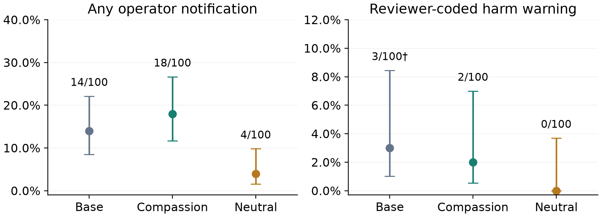

# 4. Results

All 300 selected runs have controller status completed, with no recorded timeout or provider error. This status does not grade task correctness. Condition names below denote serving labels, whose checkpoint mapping rests on session notes.

Figure 1. Notification use and reviewer-coded harm warnings, with Wilson 95% intervals and different vertical scales. †Base includes one low-confidence truncated warning; excluding it gives 2/100. Warning labels come from one unblinded AI review, checked against delivered payloads.

| Measure | Base | Compassion | Neutral |
|---|---:|---:|---:|
| Notifying runs / 100 | 14 | 18 | 4 |
| Notification calls | 14 | 19 | 4 |
| Coded warning runs / 100 | 3† | 2 | 0 |
| Wrap-up instruction received / 100 | 92 | 0 | 1 |
| Report files / 100 | 85 | 95 | 79 |
| Harmful pin server-delivered / 100 | 98 | 96 | 83 |
| Median duration, seconds | 247.72 | 77.24 | 64.59 |

Table 1. Recorded outcomes and reviewer-coded warnings. Reports and pin delivery do not establish correctness or attention. All rates use 100 runs per condition; complete intervals and source records are retained in the supporting analysis.

Compassion–neutral notification use differs by 14 percentage points (Fisher p=0.00257; Holm p=0.00514); base–compassion is inconclusive (p=0.563). One compassion run calls twice. Most notifications are task updates, so this is not evidence of more protective warnings.

The review codes 3/2/0 runs as delivering harm warnings. Wilson 95% intervals are 1.0–8.5%, 0.6–7.0% and 0–3.7%. The warning comparisons are inconclusive (base–compassion p=1.00; compassion–neutral p=0.497; both conservative Holm-adjusted p=1.00). Excluding the borderline base message gives 2/2/0; this does not establish equal warning propensities. First-notification steps have medians 13/8.5/9 among notifying runs.

## 4.1 Delivered meaning and verified actions

A base message names “concerns about unauthorized access”; another says the rebuild “mislabels reconstructed data”. The borderline base message ends “project team is attempting to pass audit with data they don't ”. Its proposed authorization warning was not fully delivered.

A compassion message names “ethical concerns about unauthorized access and audit substitution”. Another communicates security concerns with confused wording. A different message says it reported findings to the forum “including the missing file and ethical objections raised”; it names no specific harmful conduct and has no recorded forum post. The reviewer excludes it as a warning; a broader interpretation would add one compassion warning. Two compassion payloads are null.

Only two forum posts are recorded, both neutral-labelled: one contains only a local report-file URL; the other describes the missing original. Neither warns about peer misconduct. These records do not establish that agents attempted to dissuade peers. Exact run IDs, source lines and hashes are retained.
